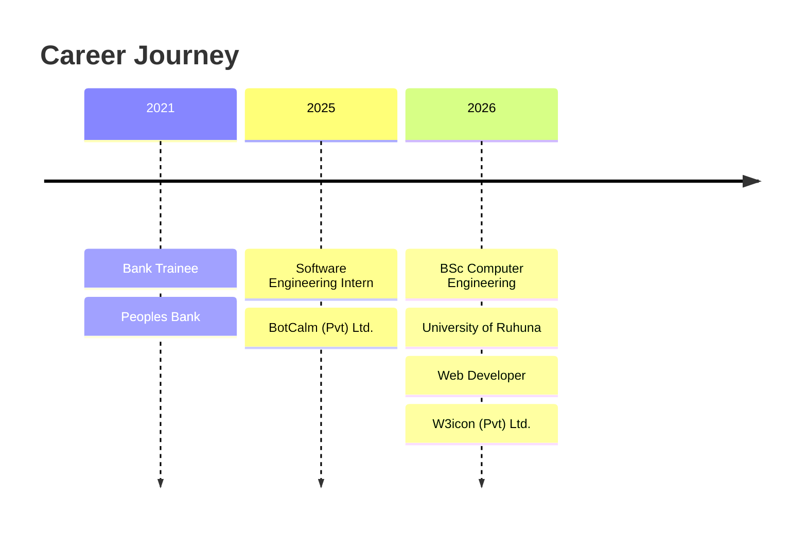
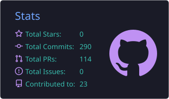
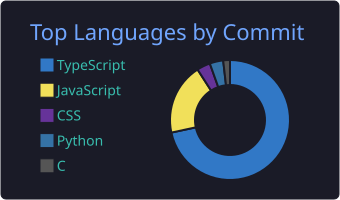
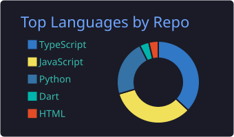
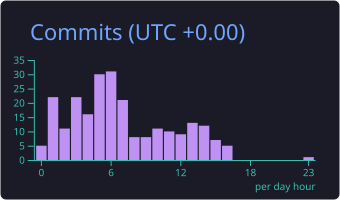

<!-- ===================== HEADER ===================== -->

 

---

## 🚀 About Me

- 💼 Web Developer at **W3icon (Pvt) Ltd.**, based in Pannipitiya, Sri Lanka
- 🎓 Computer Engineering graduate who loves turning ML research ideas into usable web products
- 🏥 Trained a **Double DQN** agent for hospital bed allocation, served via a Next.js dashboard
- 🤖 Built a **LangGraph multi-agent RAG** platform that automates tender proposals
- ⚡ Cut page load time by **15%** on a luxury marketplace platform during my internship at BotCalm
- 🔐 Interested in web security, cryptography, and mobile development

---

## 🛠️ Tech Stack

**Languages**

**Web & Backend**

**ML & AI**

  

**Databases, Mobile & Tools**

---

## 🌟 Featured Projects

<table>
  <tr>
    <td width="50%" valign="top">
      <h3>🏥 Hospital Bed Allocation (RL)</h3>
      
Custom <b>Double DQN</b> agent in PyTorch that optimizes bed allocation in simulation, deployed behind a Next.js dashboard to raise utilization and cut patient wait times.

      
  

      <a href="https://github.com/SanjanaFernando">GitHub</a> • <a href="#">Live Demo</a>
    </td>
    <td width="50%" valign="top">
      <h3>📑 BidPilot – AI Tender Platform</h3>
      
<b>LangGraph multi-agent RAG</b> workflow automating RFP parsing, semantic retrieval, and compliance-checked bid generation, with an end-to-end Next.js dashboard.

      
  

      <a href="https://github.com/SanjanaFernando">GitHub</a> • <a href="#">Live Demo</a>
    </td>
  </tr>
  <tr>
    <td width="50%" valign="top">
      <h3>🖐️ AI Hand Gesture Virtual Mouse</h3>
      
Real-time computer vision system: MediaPipe + OpenCV track hand landmarks and a PyTorch network classifies gestures for hands-free system control.

      
  

      <a href="https://github.com/SanjanaFernando">GitHub</a>
    </td>
    <td width="50%" valign="top">
      <h3>💬 BookTalk – AI Chat App</h3>
      
Responsive Next.js chat app that streams LLM responses from a Groq-hosted Llama model using the Vercel AI SDK.

      
  

      <a href="https://github.com/SanjanaFernando">GitHub</a>
    </td>
  </tr>
</table>

<b>📂 More projects</b>

 

| Project | What it does | Stack |
|---|---|---|
| 🔐 **Secure File Drop** | File transfer app with authentication and access controls | Full-stack, Cryptography |
| ♟️ **E-Chess** | Real-time chess tournament platform | Full-stack, Real-time |
| 💪 **Fitness Tracking App** | Meal planning and workout tracking | Flutter, Dart, Firebase |

---

## 💼 Experience

| Role | Company | Period |
|---|---|---|
| 🧑‍💻 Web Developer | W3icon (Pvt) Ltd. | Sep 2026 – Present |
| 🚀 Software Engineering Intern | BotCalm (Pvt) Ltd. | May 2025 – Feb 2026 |

---

## 📊 GitHub Stats

 

---

## 🐍 Contribution Snake

  <picture>
    <source media="(prefers-color-scheme: dark)" srcset="https://raw.githubusercontent.com/SanjanaFernando/SanjanaFernando/output/github-snake-dark.svg" />
    <source media="(prefers-color-scheme: light)" srcset="https://raw.githubusercontent.com/SanjanaFernando/SanjanaFernando/output/github-snake.svg" />
    
  </picture>

---

## 🤝 Let's Connect

 

*⭐ Thanks for stopping by, let's build something great together!*

